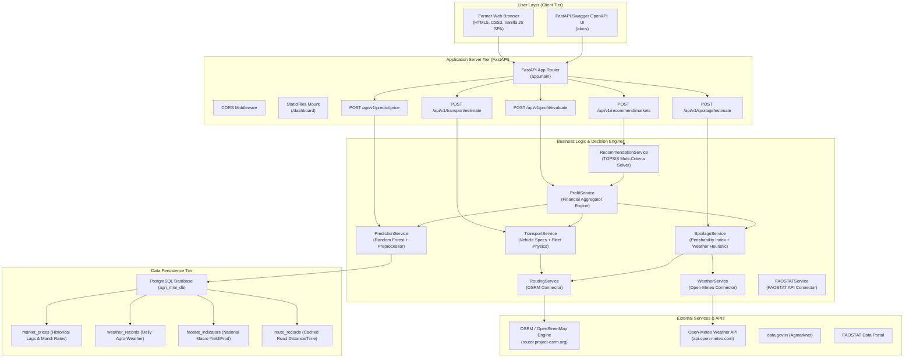
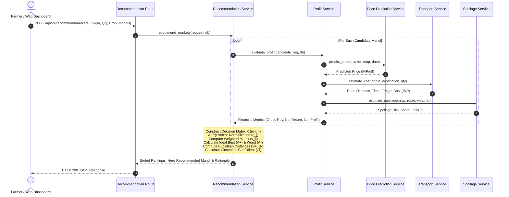

# Technical Architecture & System Design Documentation

## 1. System Overview

The **Agri_mini** platform is a multi-tier, data-driven agricultural decision-support system. It integrates multi-source geospatial and market telemetry with a machine learning price forecasting engine, a physical logistics calculation module, an agro-meteorological spoilage heuristic, and a multi-criteria decision solver (TOPSIS).

---

## 2. High-Level Component Architecture



---

## 3. Data Pipeline & Ingestion Architecture

```
[ Agmarknet / data.gov.in ] ---> [ Ingestion Pipeline ] ---> [ market_prices Table ]
[ Open-Meteo Weather API ]  ---> [ Weather Service   ] ---> [ weather_records Table ]
[ FAOSTAT Macro Data     ]  ---> [ FAOSTAT Service   ] ---> [ faostat_indicators Table ]
[ OSRM Road Routing      ]  ---> [ Routing Service   ] ---> [ route_records Table ]
```

### Key Schemas in PostgreSQL:
1. **`market_prices`**: Daily mandi prices ($N = 588$ rows in benchmark dataset) covering commodity, variety, market, district, state, modal price, min price, max price, arrival date.
2. **`weather_records`**: District-level agro-meteorological records (temperature mean/max, relative humidity, precipitation).
3. **`faostat_indicators`**: National macro production indicators (annual crop production, yield in hg/ha, harvested area).
4. **`route_records`**: Cached pairwise driving routes (origin lat/lon, destination lat/lon, distance in km, travel duration in minutes).

---

## 4. Multi-Market TOPSIS Decision Flow



---

## 5. Security & Deployment Architecture

- **Stateless Application Server**: FastAPI server runs as an independent stateless process, easily horizontally scalable behind NGINX or reverse proxies.
- **Strict Environment Isolation**: All database passwords and configuration parameters are loaded via `app.config.Settings` (Pydantic Settings) reading `.env` files. No credentials or secrets are committed to version control.
- **Fail-Safe Downstream Handling**: Isolated candidate market evaluation prevents network or data errors in a single market from crashing the entire batch recommendation.
- **Client-Side Security**: Frontend communicates purely via standardized JSON REST APIs without exposing database connections or server secrets.
